# GPIO 输入输出学习纲要

> 当前状态：已建立学习范围，待结合具体开发板逐项实验并补充波形、代码和故障记录。

## 应掌握的内容

### 1. 电气基础

- 输入、推挽输出、开漏输出和高阻态的区别。
- 上拉、下拉、悬空输入以及引脚电压、电流限制。
- 按键抖动、负载能力、电平转换和外部驱动电路。

### 2. 软件控制

- GPIO 端口、引脚编号、时钟、复用和方向配置。
- 寄存器操作、HAL/SDK 接口与读改写风险。
- 输入采样、输出翻转、软件消抖和状态机设计。

### 3. 中断与并发

- 上升沿、下降沿、双边沿和电平触发。
- 中断标志清除、ISR 执行时间及共享变量保护。
- 裸机、RTOS 任务与中断之间的数据传递方式。

## 实践清单

- [ ] 完成 LED 输出与按键输入，并测量实际电平。
- [ ] 分别实现轮询消抖和定时器/状态机消抖。
- [ ] 使用 GPIO 中断通知任务，记录误触发及处理方法。
- [ ] 阅读一次芯片手册的引脚复用表和 GPIO 寄存器说明。

## 完成标准

能够根据原理图独立配置一个引脚，解释其电气模式，并用日志、万用表或逻辑分析仪定位输入输出异常。

---

# 专题精讲：推挽、开漏、上拉下拉与复用

> 本节是上表的展开，用「内部电路 → 电气行为 → 应用场景 → 面试口径」四层把概念讲透。
> 电路图取自 [CSDN @仲南音《整理笔记——推挽输出、开漏输出》](https://blog.csdn.net/qq_34301282/article/details/133694230)（已本地化到 `images/`），文字、类比与面试要点为本站整理。

## 一、先看一张图：GPIO 引脚内部长什么样

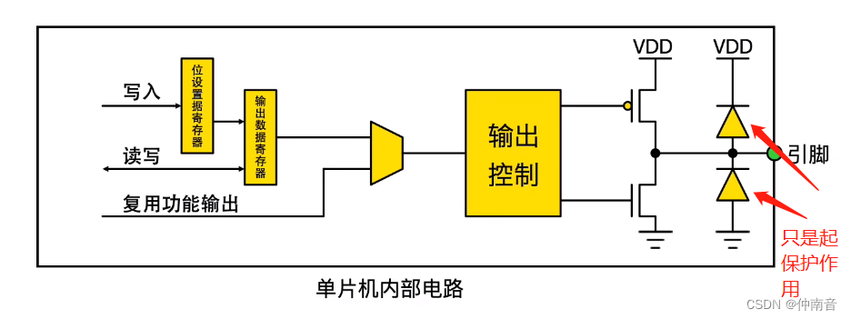

这张图是全篇的地基，记住三个位置：

| 位置 | 作用 | 记忆点 |
| :--- | :--- | :--- |
| 左侧三条输入线 | `写入` / `读写` / `复用功能输出` | 决定"谁在控制这个引脚"——软件写寄存器，还是外设（UART/PWM/I2C） |
| 中间 `输出控制` | 把 0/1 翻译成两个 MOS 的开关信号 | 推挽/开漏的差别就发生在这里 |
| 右侧 P-MOS + N-MOS | 接 VDD 的上管、接 GND 的下管 | **"双刀开关"**：上管闭合→高，下管闭合→低 |

> 最右侧两个二极管是**保护二极管**，只起钳位保护作用，不参与驱动。

### 核心类比

每个 GPIO 引脚内部，接到电源（VDD）和地（GND）各有一个可控开关。所谓「推挽」「开漏」，区别只在于**这两个开关是"都装"还是"只装下面那个"**。

- **推挽（Push-Pull）**＝双向车道：能主动推高、也能主动拉低。
- **开漏（Open-Drain）**＝单行道 + 弹簧门：只能主动拉低，松手后靠上拉电阻（弹簧）弹回高。

---

## 二、推挽输出：两个开关都装

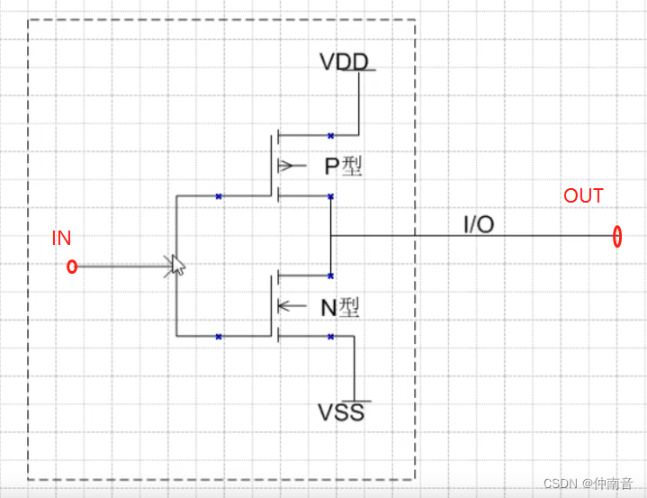

### 2.1 工作原理

| 输入 IN | P-MOS | N-MOS | 输出 OUT |
| :--- | :--- | :--- | :--- |
| 低电平 | **导通** | 截止 | VDD，高电平 |
| 高电平 | 截止 | **导通** | VSS，低电平 |

两个管子**永远一开一关**，像两个人推挽一扇门：推出去、挽回来，始终有人在后面出力。因此：

- 输出电阻小，**驱动能力强**，能直接驱动 LED、蜂鸣器、甚至小阻抗负载；
- 高低电平切换快，**边沿陡峭**，适合高速信号（SPI 的 SCK/MOSI、UART 的 TX）；
- **不需要外接上拉/下拉电阻**。

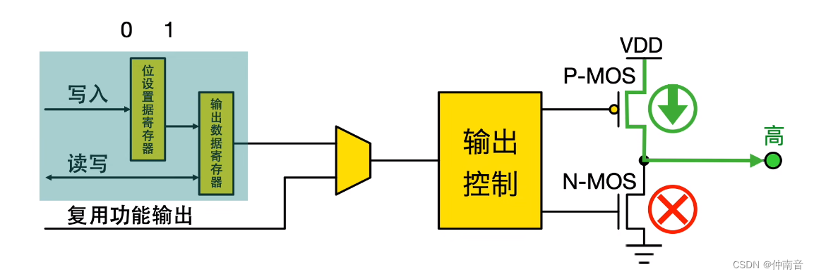

### 2.2 拉电流与灌电流（博客重点补充）

推挽输出的驱动能力用两个参数衡量，数据手册里能查到：

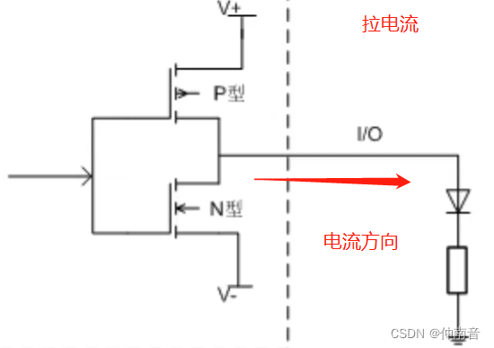

**拉电流（source current）**：LED 一端接地、另一端接引脚。引脚输出高电平时，电流**从 MCU 往外流出**。

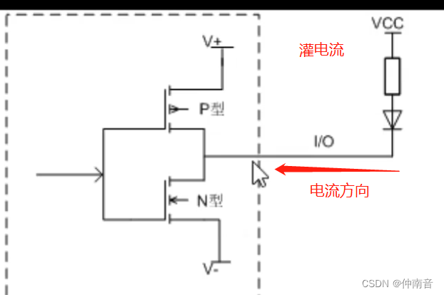

**灌电流（sink current）**：LED 一端接电源、另一端接引脚。引脚输出低电平时，电流**从外部流入 MCU 再到地**。

> **两者都是针对"引脚作为输出"而言**。设计电路时，上拉/下拉电阻的阻值要根据这两个参数选择，让电流落在芯片允许范围内。这也是为什么**驱动大电流负载（继电器、电机）必须外加三极管或 MOS 管**，不能直接挂 GPIO。

### 2.3 推挽的致命缺陷

**两个推挽输出不能接在一起。** 若 A 输出高（接 VDD）、B 输出低（接 GND），这条线相当于把电源和地**直接短接**，会流过很大电流，可能烧毁引脚。

> 面试追问答案：「两个推挽输出一个高一个低接在一起会怎样？」→ **短路，电流过大，可能损坏芯片。**

---

## 三、开漏输出：只装下面那个开关

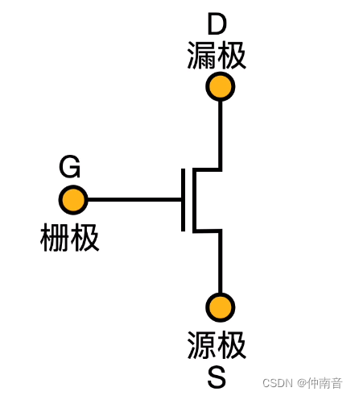

**"开漏"的"漏"就是 MOSFET 的漏极（Drain）。** 开漏输出＝把场效应管的漏极直接引出作为输出引脚，**没有上管**。

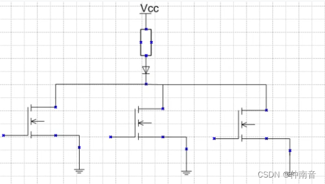

### 3.1 工作原理

| 写什么 | 实际动作 | 引脚电平 |
| :--- | :--- | :--- |
| 写 0 | 下管导通，主动接地 | **低**（强，0V） |
| 写 1 | 下管**截止**，什么都不做 | **被上拉电阻拉高**（弱，慢） |

> ⚠️ **最容易答错的一点**：开漏「写 1」**不是主动输出高电平**，而是「放手不管」。高电平是外面的上拉电阻给的。面试官问"开漏能不能输出高电平"，正确回答是：**能，但靠上拉，不是靠引脚自己**。

### 3.2 高阻态

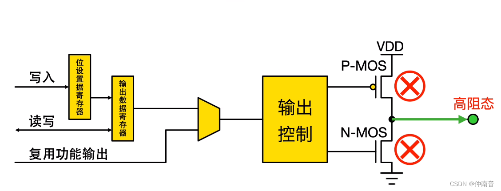

两个管子都截止时，引脚对外相当于接了**无穷大电阻**，称为**高阻态（Hi-Z）**。此时：

- 引脚电平由外部电路决定，不由 MCU 决定；
- 若外部接 5V，引脚电压就接近 5V（只要不超绝对最大额定值）；
- 这正是**电平转换**的物理基础。

### 3.3 开漏的三大价值

**① 电平匹配（博客重点）**

MCU 是 3.3V 逻辑，外设可能是 5V。开漏引脚外接 5V 上拉，输出高时就是 5V——因为此时引脚是高阻态，电压由上拉电源决定，MCU 内部不承受 5V 的驱动压力。**这减轻了 MCU 的负担**。

**② 线与逻辑（Wire-AND）**

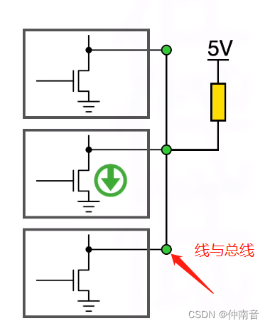

多个开漏输出接到同一根线：

- **全部输出高（都放手）** → 上拉电阻把总线拉高 → 总线为**高**
- **任意一个输出低** → 整条总线被拉低 → 总线为**低**

这就是「**线与**」：所有输出相"与"。因为每个器件只会"拉低"或"放手"，**永远不会出现一个输出高、一个输出低的对撞短路**。

> 这就是 **I2C 必须用开漏**的根本原因：SDA/SCL 上挂着主设备和多个从设备，任何一方都可能要拉低总线。MCU 也靠这个特性判断总线是否被占用（仲裁）。

**③ 多设备共享中断线**

多个器件的中断输出（低有效）可以并到一根线上接 MCU，任何一个拉低都能触发中断。

### 3.4 上拉电阻怎么选

**类比：水管的粗细。** 电阻小＝水管粗，充水快（上升沿陡）但一直漏水（耗电）；电阻大＝水管细，充水慢（上升沿缓）但省电。

| 阻值 | 上升沿 | 功耗 | 问题 |
| :--- | :--- | :--- | :--- |
| 太小（如 1 kΩ） | 快，边沿陡 | 大，写 0 时灌电流大 | 可能超过引脚灌电流上限，烧引脚 |
| 合适（如 4.7 kΩ） | 够快 | 中等 | I2C 的常规选择 |
| 太大（如 100 kΩ） | 慢，边沿圆钝 | 小 | 高速时来不及拉高，通信失败；易受干扰 |

> **为什么上升时间取决于 R×C**：导线和引脚有寄生电容（几十 pF）。上拉电阻给这个电容充电，时间常数 τ = R × C。电阻越大、线越长（电容越大），上升越慢。这就是 I2C 走线长时要减小上拉阻值、或降低速率的原因。
>
> I2C 标准：100 kHz 用 4.7 kΩ 左右，400 kHz 用 2.2 kΩ 左右，且总线总电容不超过 400 pF。

---

## 四、复用输出：让外设接管引脚

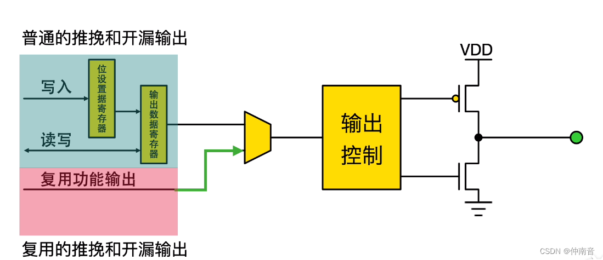

**复用（Alternate Function, AF）** 指引脚不再由软件写寄存器控制，而是**交给内部外设驱动**（PWM、USART、I2C、SPI…）。

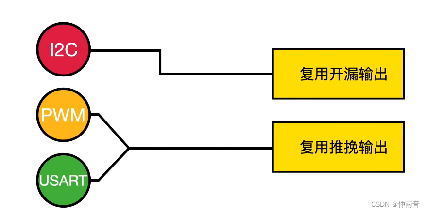

### 4.1 四种组合怎么选

| 模式 | 控制源 | 典型外设 | 选择理由 |
| :--- | :--- | :--- | :--- |
| 推挽输出 | 软件写寄存器 | LED、蜂鸣器、继电器 | 需要强驱动、确定电平 |
| 开漏输出 | 软件写寄存器 | 模拟 I2C、共享中断线 | 需要线与或电平转换 |
| **复用推挽** | 外设 | **UART、PWM、SPI** | 需要高速、确定的高低电平 |
| **复用开漏** | 外设 | **硬件 I2C** | 需要线与特性 |

> **判断口诀**：需要"线与"的用开漏（I2C），需要"高速确定电平"的用推挽（UART/PWM/SPI）。STM32 的 I2C 引脚必须配复用开漏，否则总线无法正常工作——这是新手最常踩的坑之一。

### 4.2 复用配置顺序（以 STM32 为例）

1. 使能 GPIO 端口时钟（`__HAL_RCC_GPIOx_CLK_ENABLE()`）
2. 使能外设时钟（如 `__HAL_RCC_USARTx_CLK_ENABLE()`）
3. 配置引脚为 `GPIO_MODE_AF_PP` 或 `GPIO_MODE_AF_OD`
4. 设置复用功能编号（`GPIO_AFx_XXX`）
5. 设置速度、上下拉
6. 配置外设本身（波特率、PWM 参数等）

> 少使能任何一个时钟，引脚都不会工作——这是"配置了但没反应"的头号原因。

---

## 五、上拉 / 下拉：给"没人管"的线一个默认答案

**类比：办公室的门，规定"没人推的时候，门是开着还是关着"。**

- **上拉电阻**：引脚用电阻接到 VDD，没人驱动时默认**高**。
- **下拉电阻**：引脚用电阻接到 GND，没人驱动时默认**低**。

### 5.1 为什么必须有

| 场景 | 没有上拉/下拉会怎样 | 结果 |
| :--- | :--- | :--- |
| 按键一端接引脚、一端接 GND | 不按键时引脚悬空 | 电平随机跳动，读值不可信 |
| 开漏输出写 1 | 松开后线浮空 | 高电平不确定，可能被干扰拉低 |
| I2C 总线空闲 | 所有器件都放手 | 线浮空，通信完全不可靠 |

> **"悬空"有多可怕**：悬空的引脚像一根天线，会捡到周围电磁干扰，读数在 0/1 之间乱跳。表现为按键不按也触发、程序莫名进中断。**这是嵌入式最经典的"玄学 bug"来源之一。**

### 5.2 按键电路的标准写法

| 方案 | 按键接法 | 引脚配置 | 按下时读到 |
| :--- | :--- | :--- | :--- |
| 上拉方案（最常见） | 按键另一端接 GND | 内部上拉，输入 | **0**（低电平有效） |
| 下拉方案 | 按键另一端接 VCC | 内部下拉，输入 | **1**（高电平有效） |

> STM32/ESP32 多数引脚**内部上拉比外部上拉弱**（几十 kΩ）。线长、干扰大，或驱动 I2C 时，建议用外部上拉电阻。

### 5.3 输入模式的完整分类

| 模式 | 说明 | 典型用途 |
| :--- | :--- | :--- |
| 浮空输入 | 无内部上下拉，电平完全由外部决定 | 外部已有上下拉的场合 |
| 上拉输入 | 内部接上拉电阻 | 按键（低有效）、开漏信号读取 |
| 下拉输入 | 内部接下拉电阻 | 按键（高有效） |
| 模拟输入 | 断开数字输入通路 | ADC 采样 |

---

## 六、四种模式速查总表

| 模式 | 上管 | 下管 | 能否输出高 | 能否并联 | 典型应用 |
| :--- | :--- | :--- | :--- | :--- | :--- |
| 推挽输出 | 有 | 有 | 能（强驱动） | ❌ 禁止 | LED、蜂鸣器、UART TX、SPI |
| 开漏输出 | 无 | 有 | 靠上拉（弱） | ✅ 允许（线与） | I2C、共享中断、电平转换 |
| 复用推挽 | 有 | 有 | 能 | ❌ | UART、PWM、SPI |
| 复用开漏 | 无 | 有 | 靠上拉 | ✅ | 硬件 I2C |
| 高阻输入 | 全截止 | 全截止 | — | ✅ | 读取外部信号、总线仲裁 |

---

## 七、面试追问速答

| 问题 | 通俗答法 | 加分要点 |
| :--- | :--- | :--- |
| 两个推挽输出接一起会怎样 | 电源和地短路，大电流可能烧引脚 | 说「短路」+「可能损坏」 |
| I2C 为什么必须开漏 | 多器件挂一条线，开漏只能拉低或放手，不会出现一高一低对撞 | 关键词「**线与**」 |
| 开漏写 1 是高电平吗 | 不是主动输出高，是「放手」，靠上拉电阻拉高 | 最常被挖的点 |
| 上拉阻值太大/太小 | 太大上升慢通信失败，太小耗电大甚至烧引脚 | 说「**RC 充电时间**」加分 |
| 内部上拉够用吗 | 一般够，但驱动 I2C 或线长时建议外部上拉 | 内部上拉通常几十 kΩ，偏弱 |
| 推挽和开漏怎么选 | 自己独占的线用推挽，共享的线用开漏 | 一句话区分 |
| 拉电流 vs 灌电流 | 拉＝引脚往外供电，灌＝外部电流流入引脚到地 | 都是输出模式下的参数 |
| 复用开漏和普通开漏区别 | 控制源不同：外设 vs 软件 | 硬件 I2C 必须复用开漏 |

---

## 八、动手验证（20 分钟，不用板子也能懂）

对应上文「实践清单」第一项：

1. **验证推挽**：配一个引脚为推挽输出，写 1 用万用表量到 3.3V，写 0 量到 0V。两个方向都能量到确定电压，说明它能主动驱动。
2. **验证开漏**：改成开漏输出、不接上拉，写 1 时万用表读数会飘（1~2V 之间乱跳），这就是悬空。接一个 10 kΩ 到 3.3V 再量，稳定在 3.3V。
3. **验证上下拉**：配一个引脚为输入，不接任何东西，用代码读它的值——会乱跳。开内部上拉再读，稳定为 1；开内部下拉，稳定为 0。
4. **验证复用**：把 UART TX 配成复用推挽，用逻辑分析仪或示波器看波形，再故意配成普通推挽（不配复用），观察串口无输出——理解"复用"到底改变了什么。

> 亲手量过一次"悬空时读数乱跳"，以后再被问上拉下拉，脑子里有画面，不用背。

---

## 九、常见故障与排查

| 现象 | 可能原因 | 排查方法 |
| :--- | :--- | :--- |
| 引脚配置了但没输出 | 端口时钟未使能 | 检查 `__HAL_RCC_GPIOx_CLK_ENABLE()` |
| 按键不按也触发 | 引脚悬空、无上下拉 | 万用表量电平；开内部上下拉或加外部电阻 |
| I2C 通信失败 | 未配开漏 / 未接上拉 | 查引脚模式；量 SDA/SCL 空闲电平是否为高 |
| 输出高电平只有 1.5V | 负载过重、驱动能力不足 | 查数据手册拉电流上限；加三极管驱动 |
| 两个引脚接一起后发烫 | 推挽对撞短路 | 改开漏，或加隔离 |
| 复用功能无输出 | 复用编号配错 | 查芯片手册引脚复用表（Alternate function mapping） |

---

## 十、延伸阅读

- [UART 串口通信](../protocols/uart.md)：复用推挽的典型应用
- [I2C 总线协议](../protocols/i2c.md)：开漏 + 上拉的标准案例
- [SPI 总线协议](../protocols/spi.md)：复用推挽的高速场景
- [位运算与寄存器操作](/c-language/bitwise-registers.md)：寄存器读改写风险
- [中断、并发与 volatile](/c-language/isr-concurrency.md)：GPIO 中断与共享变量
- 面试题库：[M01 推挽、开漏、上拉分别是什么](/embedded-interview/mcu-peripherals.md#m01)、[M06 中断优先级与任务优先级](/embedded-interview/mcu-peripherals.md#m06)
