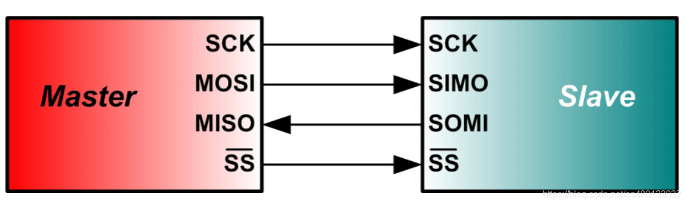
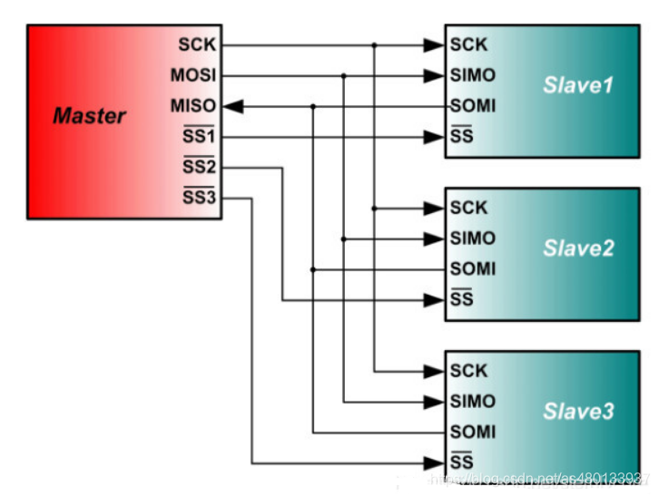
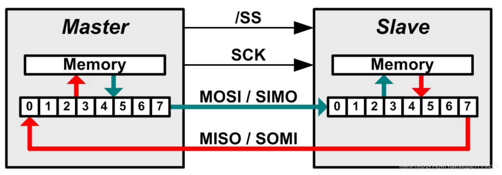
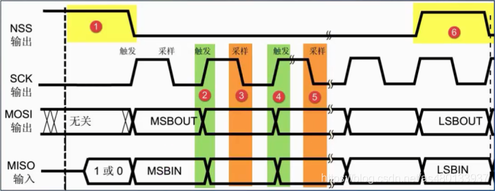
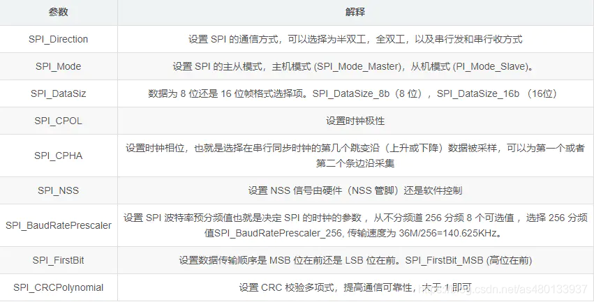

# SPI 总线协议学习纲要

> 当前状态：已建立学习范围，待结合 Flash、屏幕或传感器实验完善。

## 应掌握的内容

### 1. 总线机制

- SCLK、MOSI、MISO、CS 的作用及全双工特性。
- CPOL、CPHA 组成的四种模式，以及采样沿和改变沿。
- 位序、字长、时钟频率和片选时序。

### 2. 设备访问

- 单设备和多设备连接方式，以及独立片选管理。
- 命令、地址、空周期和数据阶段的组合。
- 轮询、中断、DMA 传输及缓存生命周期。

### 3. 性能与调试

- 控制器和从设备最高时钟、走线及信号完整性限制。
- 片选提前/延后、模式错误、字节错位和数据全零等问题。
- 使用数据手册和逻辑分析仪还原完整事务。

## 实践清单

- [ ] 读取 SPI Flash 或传感器的 JEDEC/设备 ID。
- [ ] 比较不同 SPI 模式下的波形和读取结果。
- [ ] 使用 DMA 发送一段连续数据并验证完整性。
- [ ] 降低和提高时钟频率，记录稳定性边界。

## 完成标准

能够根据从设备时序图配置 SPI，解释每一段数据的含义，并从片选、时钟边沿和位序定位错误。

---

# 专题精讲：从四根线到四种模式

> 本节把 SPI 拆成六层来讲：**直觉 → 结构 → 机制 → 时序 → 事务 → 工程**。建议按顺序读，不要跳。
>
> 配图取自 [CSDN @不脱发的程序猿《SPI原理超详细讲解》](https://blog.csdn.net/as480133937/article/details/105764119)（已本地化到 `images/`）；文字、类比、时序代码块与面试要点为本站整理。

## 一、先建立一个直觉：SPI 是一条传送带

在看任何时序图之前，先记住这个画面：

> **数据线是一条传送带，上面放着零件。时钟每跳一下，就是一次"工位动作"。**
>
> 但 SPI 有两个不同的工位，交替工作：
>
> - **换件工位**：机械手把旧零件拿走、换上新零件。这时零件在动，**不能拍照**。
> - **拍照工位**：相机拍照检查。这时零件必须已经**放稳**。
>
> 如果机械手换零件的瞬间相机拍照，就会拍到模糊、错位的画面。**SPI 的全部设计就是为了保证一件事：换的时候不读，读的时候不换。**

后面所有的 CPOL、CPHA、四种模式，都是在这个画面上做参数调整。记住这句话，剩下的都能推出来。

## 二、四根线：谁在说话



| 信号线 | 方向 | 作用 | 记忆法 |
| :--- | :--- | :--- | :--- |
| **SCLK / SCK** | 主 → 从 | 串行时钟，由主机产生，决定节奏 | 老板的打拍子声 |
| **MOSI**（Master Out Slave In，从机侧常标 SIMO） | 主 → 从 | 主机发给从机的数据 | 老板往下喊话 |
| **MISO**（Master In Slave Out，从机侧常标 SOMI） | 从 → 主 | 从机回给主机的数据 | 工人往上汇报 |
| **CS / SS**（Chip Select / Slave Select） | 主 → 从 | 片选，**低电平有效**，选中谁谁说话 | 点名叫谁发言 |

> 从机侧的引脚命名各厂商不统一：`SIMO`（Slave In Master Out）就是 MOSI，`SOMI` 就是 MISO。看到这两个词不要慌。

### 2.1 关键：CS 是每个从设备一根



SCLK、MOSI、MISO 三根线**所有从设备共用**；CS 是**每个从设备各一根**。3 个从设备就要占 3 个 GPIO。

**这是 SPI 相比 I2C 最直接的代价**——I2C 两个引脚能挂一堆设备，SPI 每多一个设备就多一个引脚。

### 2.2 SPI 没有的东西（面试常考）

SPI **不是**"总线协议"意义上的总线。它没有地址、没有仲裁、没有应答、没有流控制。主机拉低谁，就是在跟谁说话；发了数据，也不知道对方收没收到。

> **这个"什么都没有"正是它快的原因**——省掉了所有这些开销，时钟可以直接跑到几十 MHz。

## 三、数据怎么流动：两个移位寄存器在交换



这是理解 SPI 的**最关键一张图**。主机和从机内部各有一个 8 位移位寄存器，它们的输出端和输入端**首尾相连成一个环**：

```text
主机 [0][1][2][3][4][5][6][7]  →MOSI→  从机 [0][1][2][3][4][5][6][7]
      ↑                                                    │
      └──────────────── MISO ←─────────────────────────────┘
```

每来一个时钟，两个寄存器**同时**左移一位：主机把最高位移出去、从最低位收进来；从机把最高位移出去、从最低位收进来。8 个时钟之后，两个寄存器的内容**完全交换**了。

**这张图直接推出的三个结论：**

| 结论 | 说明 |
| :--- | :--- |
| **① 全双工是天然的** | 你发一个 bit 出去，必然同时收一个 bit 进来。不存在"只发不收"的物理状态。 |
| **② 读数据必须发哑字节** | 从机的数据要"被时钟推出来"。主机不发时钟，从机就吐不出数据。所以读 N 字节，主机必须发 N 个哑字节（dummy）来产生时钟。这是新手读回全 `0xFF` 的头号原因。 |
| **③ 写会收到垃圾，读会发出垃圾** | 只写不读，忽略收到的字节即可；只读不写，发出的字节内容无所谓——重要的是它产生的时钟。 |

## 四、核心：CPOL 与 CPHA（传送带拍照）

现在回到传送带的画面。要精确描述"什么时候拍、什么时候换"，需要两个参数。

### 4.1 CPOL：传送带闲着的时候，停在哪

**CPOL**（Clock Polarity，时钟极性）只回答一个问题：**没有数据传输时，时钟线是高还是低？**

- CPOL = 0 → 空闲时**低**电平
- CPOL = 1 → 空闲时**高**电平

它只影响波形"长什么样"，不决定"什么时候读"。

### 4.2 CPHA：先拍照，还是先换件

**CPHA**（Clock Phase，时钟相位）决定节拍从哪个动作开始：

- **CPHA = 0：先拍照，再换零件。** 第一位零件必须在时钟开始前就摆好；第一个边沿直接拍，第二个边沿才换下一位。
- **CPHA = 1：先换零件，再拍照。** 第一个边沿先把第一位摆上去，第二个边沿再拍；之后每个周期都是先换后拍。

> **"相位"这个词的由来**：CPHA 把拍照时机从周期的**开头**挪到了**中间**，相当于把采样点推迟了半个周期——这就是"相位"（phase）的字面意思。
>
> **关键推论**：CPHA=0 时，第一个 bit 必须在 CS 拉低的那一刻就摆在数据线上（因为第一个沿马上就要拍它）；CPHA=1 时，CS 拉低时线上还没有有效数据，第一个沿才把第一位推出去。

### 4.3 两个沿：一个换件，一个拍照

SPI 时钟的每个周期有两个边沿，它们**分工明确、永不重合**——这是 SPI 设计的第一原则：

- **改变沿（Toggling edge）**：机械手在这一刻换零件，数据**正在变化**。
- **采样沿（Sampling edge）**：相机在这一刻拍照，数据必须**稳定**。

四个模式的区别，就是这两个沿分别落在时钟周期的哪个位置。

## 五、四种模式的完整波形

### 5.1 "第 1 个 / 第 2 个边沿"怎么数

**不是"第一个上升沿"，而是"第一个离开空闲电平的沿"。**

```text
CPOL = 0（空闲低）
        ┌─────┐           ┌─────┐
________┘     └───────────┘     └________
        ↑     ↓           ↑     ↓
      边沿1  边沿2       边沿1  边沿2
    离开空闲 回到空闲    离开空闲 回到空闲
     =上升沿  =下降沿     =上升沿  =下降沿
```

```text
CPOL = 1（空闲高）
‾‾‾‾‾‾‾‾┐     ┌───────────┐     ┌‾‾‾‾‾‾‾‾
        ↓     ↑           ↓     ↑
      边沿1  边沿2       边沿1  边沿2
    离开空闲 回到空闲    离开空闲 回到空闲
     =下降沿  =上升沿     =下降沿  =上升沿
```

> ⚠️ **最常见的误解**：以为"第一个边沿"永远是上升沿。**错。** CPOL=1 时第一个边沿是**下降沿**——时钟要先从高掉到低，才算"离开空闲"。**编号跟着"离开/回到空闲"走，不跟着上升下降走。**

### 5.2 Mode 0（CPOL=0, CPHA=0）—— 先拍照

```text
CS    ‾‾\_________________________________/‾‾
              ┌────┐          ┌────┐
SCLK  ________┘    └──────────┘    └────────
              ↑    ↓          ↑    ↓
            拍照  换件       拍照  换件
MOSI  ========X=b7=X==b6=======X=b5=X==b4==
```

时钟空闲低。**b7 在 CS 拉低时就已经摆好**。第一个上升沿直接拍照采 b7，随后下降沿换 b6 上去；下一个上升沿拍 b6……

### 5.3 Mode 1（CPOL=0, CPHA=1）—— 先换件

```text
CS    ‾‾\_________________________________/‾‾
               ┌────┐          ┌────┐
SCLK  _________┘    └──────────┘    └──────
               ↑    ↓          ↑    ↓
             换件  拍照       换件  拍照
MOSI  =========X=b7=X==b6=======X=b5=X==b4=
```

还是空闲低，但**第一个上升沿不再拍照，而是把 b7 推出去**。等 b7 稳定了，下降沿才拍它。

> **对比 Mode 0 和 Mode 1：时钟波形一模一样，差别只在"哪个沿拍照"。** 这就是 CPHA 的全部作用——不改变波形，只改变读取时机。

### 5.4 Mode 2（CPOL=1, CPHA=0）—— 空闲高，先拍照

```text
CS    ‾‾\_________________________________/‾‾
SCLK  ‾‾‾‾‾┐      ┌──────────┐      ┌──────
           ↓      ↑          ↓      ↑
         拍照    换件        拍照   换件
```

时钟空闲**高**。第一个边沿是**下降沿**，它拍照。然后上升沿换下一位。

### 5.5 Mode 3（CPOL=1, CPHA=1）—— 空闲高，先换件

```text
CS    ‾‾\_________________________________/‾‾
SCLK  ‾‾‾‾‾┐      ┌──────────┐      ┌──────
           ↓      ↑          ↓      ↑
         换件    拍照        换件   拍照
```

空闲高，第一个下降沿**换件**，第二个上升沿**拍照**。

### 5.6 四条规律，不用背表

| 模式 | CPOL | CPHA | 空闲电平 | 第 1 沿（离开空闲） | 第 2 沿（回到空闲） |
| :--- | :--- | :--- | :--- | :--- | :--- |
| **Mode 0** | 0 | 0 | 低 | **拍照**（上升） | 换件（下降） |
| **Mode 1** | 0 | 1 | 低 | 换件（上升） | **拍照**（下降） |
| **Mode 2** | 1 | 0 | 高 | **拍照**（下降） | 换件（上升） |
| **Mode 3** | 1 | 1 | 高 | 换件（下降） | **拍照**（上升） |

**两条记忆规律：**

1. **拍照沿**：Mode 0 上升、Mode 1 下降、Mode 2 下降、Mode 3 上升。即 **0/3 采上升，1/2 采下降**。
2. **Mode 0 和 Mode 3 只差空闲电平**，拍照沿和换件沿完全相同。这就是为什么很多器件手册写「支持 Mode 0 和 Mode 3」——对它们来说采样时序没区别。

## 六、一次完整的 SPI 事务



把上面所有内容串起来，读一次 SPI Flash 的 ID 是这样的：

| 阶段 | 动作 | 说明 |
| :--- | :--- | :--- |
| ① | CS 拉低 | 选中这个从设备。注意 CS 拉低到第一个时钟沿之间通常有建立时间要求 |
| ② | 发命令 `0x9F` | JEDEC ID 命令。这一字节期间 MISO 上从机也在回东西，内容无意义，丢掉 |
| ③ | 发 3 个哑字节 | 主机发什么不重要，**重要的是产生时钟**，让从机把数据推出来 |
| ④ | 从 MISO 读 3 字节 | 厂商 ID + 存储类型 + 容量，如 `EF 40 18` = Winbond W25Q128 |
| ⑤ | CS 拉高 | 结束事务。拉高后要等一段时间（tSHSL）才能开始下一次 |

> ⚠️ **新手最常犯的错：忘了哑字节。** 很多人以为"发了命令就能收到数据"，结果读回全 `0xFF`。原因：**从机只有在有时钟的时候才会吐数据**。读 N 字节，主机就必须发 N 个哑字节来产生时钟。
>
> 这是 SPI 与 I2C 最大的思维差异——I2C 有"读"这个独立动作，SPI 没有。

## 七、工程落地：STM32 配置与排错

### 7.1 配置参数逐项对照



```c
SPI_InitTypeDef SPI_InitStructure;

SPI_InitStructure.SPI_Direction         = SPI_Direction_2Lines_FullDuplex; // 双线全双工
SPI_InitStructure.SPI_Mode              = SPI_Mode_Master;                 // 主机
SPI_InitStructure.SPI_DataSize          = SPI_DataSize_8b;                 // 8 位帧
SPI_InitStructure.SPI_CPOL              = SPI_CPOL_High;                   // 空闲高
SPI_InitStructure.SPI_CPHA              = SPI_CPHA_2Edge;                  // 第 2 沿采样 → Mode 3
SPI_InitStructure.SPI_NSS               = SPI_NSS_Soft;                    // 软件管理片选
SPI_InitStructure.SPI_BaudRatePrescaler = SPI_BaudRatePrescaler_256;       // 分频
SPI_InitStructure.SPI_FirstBit          = SPI_FirstBit_MSB;                // 高位先发
SPI_InitStructure.SPI_CRCPolynomial     = 7;                               // CRC 多项式
SPI_Init(SPI2, &SPI_InitStructure);
```

> 上例 `CPOL_High` + `CPHA_2Edge` 就是 **Mode 3**。改模式只需动这两行。
>
> 引脚必须配成 `GPIO_Mode_AF_PP`（**复用推挽**）——配成普通推挽不会有输出，因为 SCLK/MOSI 由 SPI 外设驱动，不是软件写寄存器。

### 7.2 排错速查

| 现象 | 最可能的原因 | 怎么查 |
| :--- | :--- | :--- |
| 读回全 `0xFF` | ① 没发哑字节；② MISO 没接；③ CS 没拉低 | 逻辑分析仪看 CS/SCLK 有无波形 |
| 读回全 `0x00` | MISO 被拉死；从机没供电；模式不对 | 先量从机 VCC，再看波形 |
| 数据像"整体右移一位" | **在换件的沿拍照了（CPHA 错）** | **CPHA 取反** |
| 偶尔对偶尔错 | 采样点太靠近翻转沿，建立时间不够 | 降速；查走线 |
| 第一个字节对、后面全错 | CS 在字节之间被拉高，事务被拆断 | 确认整个事务 CS 保持低 |
| 高速正常、低速反而错 | 某些器件对**最小**时钟频率有要求 | 查手册 fSCLK min |
| 多设备互相干扰 | CS 悬空被干扰，多个从机同时驱动 MISO | **每根 CS 加 10kΩ 上拉** |

> **排错顺序：先改 CPHA，再改 CPOL。** CPHA 直接决定在哪个沿采样，配错必然采到正在翻转的数据；CPOL 配错只是时钟反相，有时碰巧还能工作。先动 CPHA 命中率更高。

### 7.3 一个危险的硬件问题

如果两根 CS 都意外为低（比如某根悬空被干扰），两个从机会**同时往 MISO 上驱动电平**——一个输出高、一个输出低，形成推挽对撞，可能损坏从设备。

**解法：每根 CS 都加上拉到 VCC**，保证空闲时所有从机都处于"未被选中"状态。这是 SPI 硬件设计的基本功。

## 八、面试追问速答

| 问题 | 答题要点 | 加分项 |
| :--- | :--- | :--- |
| 四种模式怎么区分 | CPOL 定空闲电平，CPHA 定在第几个沿采样 | 能现场画 Mode 0 和 Mode 3 |
| "第 1 个边沿"是什么 | **离开空闲电平**的沿，不是"第一个上升沿" | 指出 CPOL=1 时第 1 沿是下降沿 |
| 为什么 SPI 比 I2C 快 | 全双工 + 推挽 + 无地址无应答开销 | I2C 是开漏，上升靠 RC 充电，天生慢 |
| SPI 有应答机制吗 | **没有**，主机不知道从机收没收到 | 所以关键数据要加 CRC 或读回校验 |
| 为什么读数据要发哑字节 | 从机需要时钟才能把数据推出来 | 说出"移位寄存器环"这个机制 |
| 多个从设备怎么接 | 独立片选最常用，也可菊花链 | 菊花链代价：数据要穿过前面设备 |
| CS 为什么低有效 | 失效安全：断线时默认为高（未选中） | "失效安全"这个词能加分 |
| 最大速率受什么限制 | 从设备手册上限、走线、信号完整性 | 提到 tSU/tHD 建立保持时间 |
| Mode 0 和 Mode 3 区别 | **只差空闲电平**，采样沿相同 | 解释为何很多器件"同时支持 0 和 3" |

## 九、动手验证

对应上文「实践清单」：

1. **读 JEDEC ID**：找一片 W25Q Flash，发 `0x9F` + 3 个哑字节，读回 3 字节。成功后你就真正理解了"哑字节"的意义。这是 SPI 的 Hello World。
2. **故意配错模式**：把 Mode 0 改成 Mode 1 再读 ID，观察读到什么（大概率全 `0xFF` 或错位数据）。**亲手制造一次错误，比看十遍表有用。**
3. **用逻辑分析仪抓一次完整事务**：抓 CS、SCLK、MOSI、MISO 四根线，看清楚"数据在哪个沿变化、哪个沿稳定"。这是 SPI 唯一真正需要"看见"的东西。
4. **验证 DMA**：用 DMA 发一段连续数据，对比 CPU 轮询方式的耗时差异，记录缓冲区生命周期。

> 手边没有 Flash 也行——任何 SPI 传感器（BMP280、MPU6050 的 SPI 模式、ADS1118）都能做同样的实验：发命令 → 发哑字节 → 读回。

## 十、与其他总线的横向对比

| 维度 | SPI | I2C | UART |
| :--- | :--- | :--- | :--- |
| 线数 | 4 根 + 每设备 1 根 CS | 2 根 | 2 根 |
| 速度 | 高，几十 MHz | 中，100k~3.4M | 低~中 |
| 双工 | **全双工** | 半双工 | 全双工 |
| 寻址 | 无地址，靠**片选** | 7/10 位地址 | 点对点 |
| 应答 | **无** | 有 ACK/NACK | 无 |
| 电气 | **推挽** | **开漏 + 上拉** | 推挽 |
| 典型用途 | Flash、LCD、SD 卡、高速 ADC | 传感器、EEPROM、RTC | 调试口、GPS、蓝牙模组 |

> **一句话选择**：要快且设备少 → SPI；要省引脚且设备多 → I2C；点对点 → UART。

---

## 十一、延伸阅读

- [GPIO 输入输出](../peripherals/gpio.md)：推挽/开漏、复用、上拉下拉的电气基础
- [I2C 总线协议](i2c.md)：开漏 + 上拉的标准案例，与 SPI 形成对照
- [UART 串口通信](uart.md)：另一种全双工，但没有时钟线
- [位运算与寄存器操作](/c-language/bitwise-registers.md)：SPI 寄存器配置基础
- 面试题库：[M05 SPI 四种模式怎么区分](/embedded-interview/mcu-peripherals.md#m05)、[M07 DMA 与 Cache](/embedded-interview/mcu-peripherals.md#m07)
